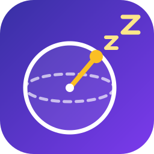

<p align="center">
  
</p>

<h1 align="center">LazyQC</h1>

<p align="center">
  <a href="https://github.com/IraitzM/LazyQC/actions/workflows/ci.yml"></a>
  <a href="https://github.com/IraitzM/LazyQC/blob/main/LICENSE"></a>
  
  <a href="https://pypi.org/project/lazyqc/"></a>
  <a href="https://github.com/IraitzM/LazyQC/stargazers"></a>
</p>

LazyQC is an open-source Python framework for lazy, observable-driven quantum simulation. You describe programs and request expectation values first; LazyQC plans the whole batch (observable cones, shared preparations, optional ZX rewrites and exact CX cuts under memory limits) and only runs the native [Qulacs](https://github.com/qulacs/qulacs) simulation when you call `collect()`.

## Installation

Requires Python 3.12 or newer. With [uv](https://docs.astral.sh/uv/):

```sh
uv add lazyqc
```

Optional extras: `zx` (PyZX rewrites), `cutting` (exact CX cuts, Qiskit frontend), `tensor` and `mqt` (alternative backends for benchmarking).

### PennyLane device

With `pip install "lazyqc[pennylane]"`, any QNode can run on LazyQC:

```python
import pennylane as qml

dev = qml.device("lazyqc.qubit", wires=4)

@qml.qnode(dev, diff_method="best")  # device derivatives skip parameters outside every cone
def f(w):
    qml.RX(w[0], wires=0)
    qml.CNOT(wires=[0, 1])
    return qml.expval(qml.Z(1))
```

`dev.last_stats["skipped_structural_zeros"]` reports shifted terms skipped after a gradient call.

## Quick start

```python
from lazyqc import Program, plan_all

program = Program(4).ry(0, 0.4).cx(0, 1).ry(2, 0.8).cx(2, 3)
requests = [
    program.expectation({0: "Z"}),
    program.expectation({0: "X", 1: "X"}),
    program.expectation({2: "Z", 3: "Z"}),
]

plan = plan_all(requests, strategy="auto")  # classical planning only
print(plan.explain())
print(plan.collect().values)  # native simulation happens here
```

## Gradients

For bound symbolic parameters, `adjoint_gradient` computes a weighted scalar-loss
gradient with Qulacs backpropagation inside each observable's causal cone. Observables
with the same cone share a backpropagation:

```python
from lazyqc import Parameter, Program, adjoint_gradient

theta = Parameter("theta")
program = Program(2).ry(0, theta).cx(0, 1).rz(1, theta).bind(theta=0.4)
gradient = adjoint_gradient(program, [{0: "Z"}, {1: "X"}], [0.7, -0.2])
print(gradient["theta"])
```

`profile_sensitivity(..., method="adjoint")` computes occurrence-wise derivatives;
`method="auto"` selects shifts or adjoint independently for each observable cone.

More examples live in [`examples/`](https://github.com/IraitzM/LazyQC/blob/main/examples) and [`notebooks/`](https://github.com/IraitzM/LazyQC/blob/main/notebooks), and design notes and results in [`docs/`](https://github.com/IraitzM/LazyQC/blob/main/docs).

## Development

```sh
uv sync --locked --all-extras
uv run pytest -q
```

## Contributing

Contributions are welcome. Please read our [Code of Conduct](https://github.com/IraitzM/LazyQC/blob/main/CODE_OF_CONDUCT.md) before opening an issue or pull request.

## Citation

If you use LazyQC in your research, please cite the accompanying paper (see also [`CITATION.cff`](https://github.com/IraitzM/LazyQC/blob/main/CITATION.cff)):

```bibtex
@article{montalban2026lazyqc,
  title   = {LazyQC: Lazy Planning for Batched Quantum Result Queries},
  author  = {Montalb{\'a}n, Iraitz},
  journal = {TODO},
  year    = {2026},
  doi     = {TODO}
}
```
